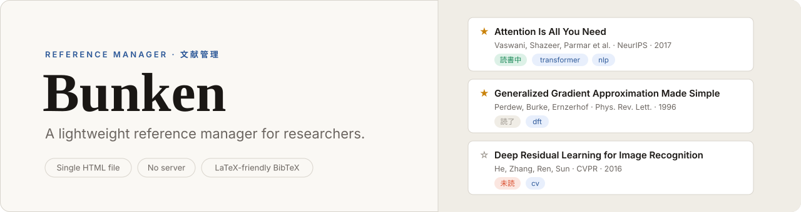
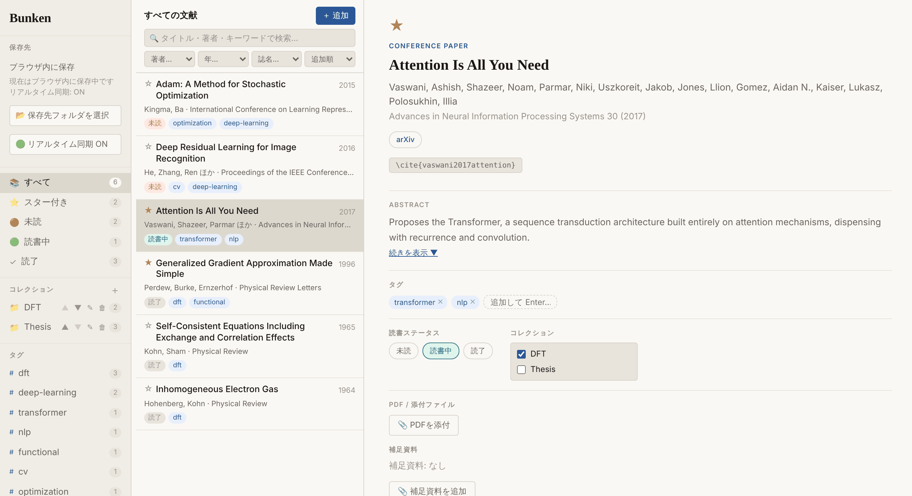
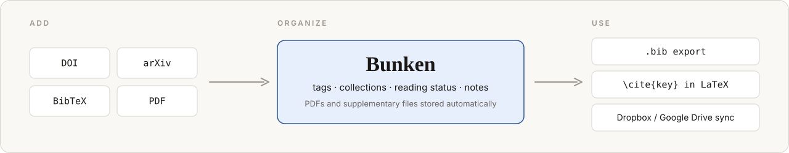

<p align="center">
  <picture>
    <source media="(prefers-color-scheme: dark)" srcset="docs/assets/banner-dark.svg">
    
  </picture>
</p>

<p align="center">
  <b>English</b> · <a href="README.ja.md">日本語</a>
</p>

<p align="center">
  <a href="LICENSE"></a>
  
  
  
</p>

Bunken is a lightweight reference manager for researchers. It is a single HTML file: open it in your browser, add papers, and keep your library and PDFs in a folder you control.

**Use at your own risk.**

<p align="center">
  <picture>
    <source media="(prefers-color-scheme: dark)" srcset="docs/assets/screenshot-dark.png">
    
  </picture>
  <br>
  <sub>Library view with demo data. The interface is available in English and Japanese, and follows your system's light or dark theme.</sub>
</p>

## Workflow

<p align="center">
  <picture>
    <source media="(prefers-color-scheme: dark)" srcset="docs/assets/workflow-dark.svg">
    
  </picture>
</p>

## Features

| Area | Details |
|---|---|
| **Add** | Fetch bibliographic data from a DOI or arXiv ID, import one or more BibTeX entries (UTF-8), or extract metadata from a PDF |
| **Organize** | Tags, collections (one paper can belong to several), reading status, and notes. Duplicate check within a collection |
| **Files** | PDFs and supplementary files are organized and stored automatically |
| **Cite** | LaTeX-friendly BibTeX export for a paper or a whole collection, one-click `\cite{key}` copy (abstract omitted by default) |
| **Language** | English and Japanese interface. Bunken follows your browser language on first launch, and you can switch any time from the bottom of the sidebar |
| **Store** | Library and files live in a storage folder you choose. Pick a folder synced by Dropbox or Google Drive to use the same library on multiple devices |

## Quick Start

1. Download `bunken.html` and open it in Chrome or Edge
2. Optionally choose a storage folder
3. Add papers via DOI, arXiv, BibTeX, or PDF

## BibTeX and LaTeX

Bunken is intentionally focused on a lightweight LaTeX workflow. BibTeX import and export use UTF-8 and support common fields such as `author`, `title`, `journal`, `booktitle`, `year`, `volume`, `number`, `pages`, `publisher`, `doi`, `url`, and arXiv `eprint`. Common entry types include `article`, `inproceedings`, `book`, `preprint`, `misc`, `phdthesis`, and `mastersthesis`.

Exports omit `abstract` by default to keep `.bib` files compact; abstracts remain available inside Bunken. Bunken does not provide Word or Word-compatible export.

## Notes

- Data is stored locally in your browser or in a selected local folder
- No server is required
- An internet connection is needed to fetch from a DOI or arXiv ID and to extract metadata from PDFs (these use CrossRef, arXiv, and the PDF.js library loaded from a CDN). Everything else, including BibTeX import and export, works offline
- If you choose a folder synced by Dropbox, Google Drive, or a similar service, you can access the same library from multiple devices (avoid simultaneous edits on multiple devices)
- Supported browsers: recent Chrome and Microsoft Edge versions
- The “Markdown for AI” export is currently always written in Japanese, regardless of the interface language

## Development check

Run the dependency-free smoke tests with Node.js:

```sh
node tests/bibtex-smoke.mjs   # BibTeX import and export
node tests/i18n-smoke.mjs     # every UI string has an English translation
```

UI text is written in Japanese in the source and translated through the `I18N_EN` dictionary in `bunken.html`. When you add or edit a UI string, update the dictionary too; `i18n-smoke.mjs` fails if they drift apart.

## Community and support

- [Code of Conduct](CODE_OF_CONDUCT.md)
- [Contributing Guide](CONTRIBUTING.md)
- [Security Policy](SECURITY.md)

Please use [GitHub Issues](https://github.com/Taniuchi-Taiyo/Bunken/issues) for bug reports and feature requests. For security vulnerabilities, please follow the [Security Policy](SECURITY.md) instead of opening a public issue.

## Citation

If Bunken is useful in your work, see [`CITATION.cff`](CITATION.cff) for how to cite it.

## License

[MIT License](LICENSE)
